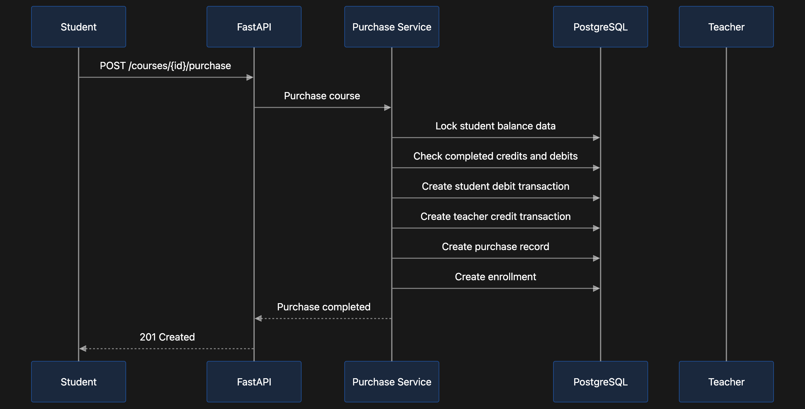

# EduMindAI Architecture

## Overview

EduMindAI uses a client-server architecture.

The React frontend shows the interface in the browser. The FastAPI backend contains application rules, works with the database, calls AI services, and starts background tasks.

## Main Architecture Decisions

1. FastAPI was chosen because it provides typed API development, validation, and automatic API documentation.
2. PostgreSQL was chosen because the project has relational data: users, courses, enrollments, assignments, purchases, and transactions.
3. SQLAlchemy and Alembic were chosen to manage database models and controlled schema changes.
4. Celery and Redis were chosen for email notifications and scheduled deadline reminders.
5. The wallet uses a transaction ledger because payment history must be traceable.
6. Docker Compose was chosen because the project contains multiple services that must run together.
7. Nginx serves the compiled frontend and forwards API requests internally, reducing public exposure of backend services.

## Backend Layers

API route -> Service -> Repository -> SQLAlchemy Model -> PostgreSQL Database

## Payment Flow

## Background Task Flow

